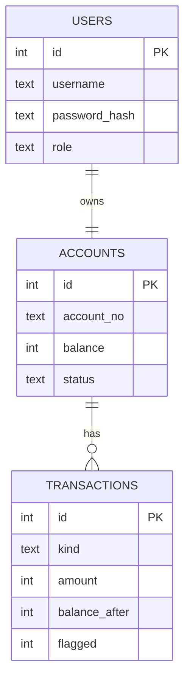

# Mini Core Banking System

A small banking application built with **Python, Flask and SQLite**. Customers can open an
account, deposit, withdraw and transfer money. A branch manager can freeze accounts and
review flagged transactions.


## Features
- Customer registration and login (hashed passwords, lockout after 5 wrong attempts)
- Deposit, withdraw and transfer with a full transaction statement
- Role based access: customer and manager
- Fraud rule: transactions of Rs 50,000 or more are flagged for the manager
- Manager can freeze or unfreeze accounts
- CSRF protection, parameterised SQL, input validation
- Automated tests with GitHub Actions

## Design decisions
| Decision | Why |
|---|---|
| Money stored as integer paise | Floats cannot represent decimals exactly |
| `UPDATE ... WHERE balance + ? >= 0` | Balance check and update are one atomic step, so simultaneous withdrawals cannot overdraw |
| `BEGIN IMMEDIATE` transaction around transfers | Debit and credit succeed together or are both rolled back (ACID) |
| `CHECK (balance >= 0)` in the schema | The database itself refuses a negative balance, even if the code has a bug |
| Ledger table, never edited | Every change is an auditable row with the balance after it |

## Database


## Run it locally
```bash
git clone https://github.com/<your-username>/mini-core-banking.git
cd mini-core-banking
python -m venv .venv
source .venv/bin/activate        # Windows: .venv\Scripts\activate
pip install -r requirements.txt

flask --app app create-manager admin   # asks for a password
python app.py                          # open http://127.0.0.1:5000
```
Set `SECRET_KEY` as an environment variable for anything other than local testing.

## Run the tests
```bash
python -m pytest -q
```

## Ideas for next steps
- Fraud detection module in Python (scikit-learn on a Kaggle dataset) feeding the flag column
- REST API with JWT, then a React frontend
- Switch to PostgreSQL and deploy on Render or Railway
- Interest calculation and fixed deposits
